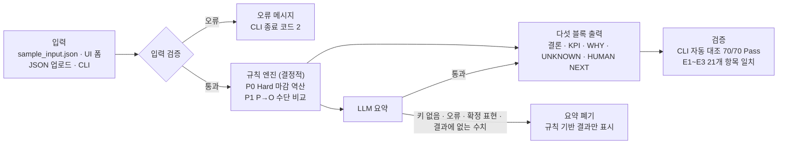
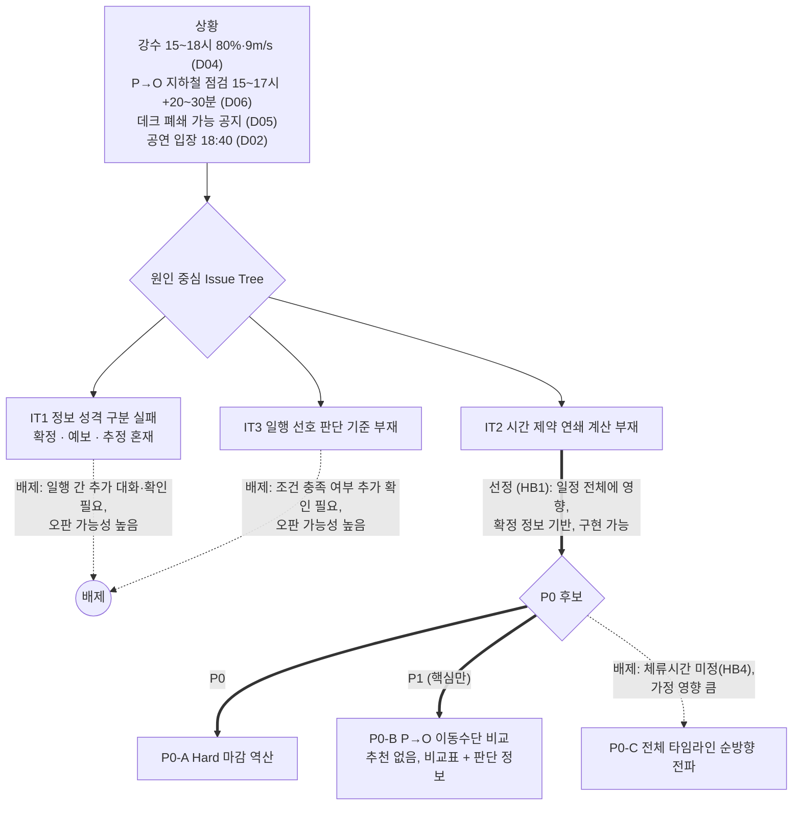
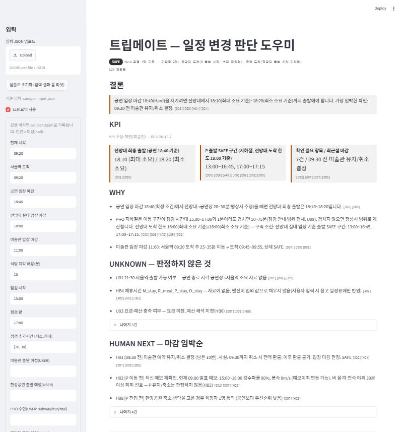
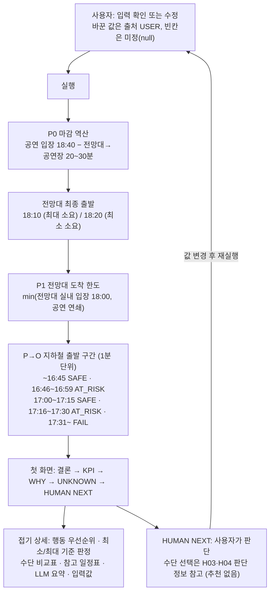

# 트립메이트 — 여행 일정 변경 대응 AI Assistant

> 📌 **결과 요약 페이지**입니다. 설치·실행 방법과 상세 근거는 아래 ①~④를 따릅니다.

## 결과 요약

### 1. 문제와 선정

토요일 서울 당일 여행 중인 4명은 09:20에 서울역에 도착해 21:30에 출발합니다(D01). 당일 아침 예보는 15~18시 강수확률 80%, 풍속 9m/s로 바뀌었습니다(D04). 15~17시에는 한강공원에서 전망대로 가는 지하철 구간이 점검으로 20~30분 더 걸릴 수 있다는 안내가 나왔고(D06), 전망대 야외 데크는 강풍이 불면 닫힐 수 있습니다(D05). 일행이 가장 중요하게 여기는 공연은 18:40까지 입장해야 하며 환불되지 않습니다(D02).

일정 판단이 어려운 원인은 세 가지로 나눴습니다.

| 원인 | 내용 | 처리 |
|---|---|---|
| IT1 | 확정 정보와 예보·추정이 섞여 있습니다 | 제외 — 일행 간 대화와 추가 확인이 먼저 필요하고 오판 가능성이 높습니다 |
| **IT2** | 여러 마감과 범위로 주어진 이동시간이 이어지는데, 장소마다 언제까지 출발해야 하는지 계산한 정보가 없습니다 | **선정** — 확정 정보만으로 일정 전체에 영향을 주는 판단을 계산할 수 있습니다 |
| IT3 | 일행의 선호를 비교할 기준이 없습니다 | 제외 — 조건 충족 여부를 더 확인해야 하고 오판 가능성이 높습니다 |

### 2. 구현 범위

P0는 Hard 마감 역산입니다. 공연 입장 마감에서 전망대→공연장 소요(20~30분)를 빼 전망대 최종 출발 시각을 구하고, 같은 방식으로 식당 예약과 미술관 입장창을 계산합니다. P1은 한강공원→전망대 구간의 지하철·버스·택시 비교입니다. 출발 시각을 1분 단위로 바꿔 가며 상태를 계산하되, 어느 수단을 탈지는 추천하지 않습니다. 전체 일정을 순방향으로 짜는 방식(P0-C)은 체류시간이 자료에 없어 가정이 결과를 좌우하므로 범위에서 뺐습니다.

판정은 결정적 규칙 엔진이 내리고, LLM은 결과 요약만 씁니다. LLM 문장에 확정 표현이나 결과에 없는 수치가 들어가면 요약을 버리고 규칙 기반 결과만 보여 줍니다. 결과 문장마다 D01~D08, USER, CALC 같은 출처 ID를 붙였습니다.

### 3. 화면

첫 화면에는 **결론 → KPI → WHY → UNKNOWN → HUMAN NEXT** 다섯 블록만 둡니다. 행동 우선순위, 최소·최대 소요 기준 판정, 수단 비교표, 참고 일정표, LLM 요약, 입력값은 접어 두었습니다.

상태는 세 단계입니다. 최대 소요로도 마감을 지키면 SAFE, 최소 소요일 때만 지키면 AT_RISK, 그마저 안 되면 FAIL입니다. 판정할 수 없는 Hard 항목이 하나라도 있으면 전체 배지를 SAFE가 아닌 UNKNOWN으로 표시합니다. 폼, JSON 업로드, CLI 어느 쪽으로 입력을 바꿔도 소스 수정 없이 다시 계산합니다.

### 4. 주요 결과

| 입력 | 결과 | 근거 |
|---|---|---|
| 원본 | 전망대 최종 출발 18:10(최대 소요) / 18:20(최소 소요) | D02, D03 |
| 원본 | 한강공원→전망대 지하철 출발: ~16:45 SAFE · 16:46~16:59 AT_RISK · 17:00~17:15 SAFE · 17:16~17:30 AT_RISK · 17:31~ FAIL | D02, D03, D06 |
| 공연 마감 18:00 (V4) | 전망대 도착 한도 17:30/17:40, 지하철 SAFE 구간 13:00~16:15 | D02 변형 |
| 서울역 도착 10:40 | 미술관 입장창 FAIL | D02, D03 |
| 식사 90분 (USER) | 참고 일정표의 식당 출발 14:30 | USER |

16시대 후반 출발이 17시 직후 출발보다 위험한 것은, 이동 구간이 점검 시간대와 겹치면 점검 지연을 반영하기 때문입니다(AP2).

### 5. 검증

입력 25개로 시험했습니다. 구성은 독립 expected E1~E3, 변형 V1~V8, 이상 입력 X_*, 독립 검증 oracle O_*입니다. 여기에 LLM 점검 5종과 UI 조작 시험을 더했습니다. 최종 5회차에서 **CLI 자동 대조 70건이 모두 통과**했고, E1~E3 21개 항목이 기대값과 같았으며, 금지 표현은 0건이었습니다.

독립 검증에서 중대 오류 세 건이 나왔고, 모두 수정한 뒤 전체 재검증에서 통과했습니다.

| 오류 | 내용 |
|---|---|
| E-1 | 공연 마감 연쇄가 빠져, 공연을 못 지키는 출발도 SAFE로 보였습니다 |
| E-2 | 판정 불가 Hard가 있는데도 SAFE로 표시됐습니다 |
| E-3 | 초기화 후 폼 값이 남았습니다 |

구버전 expected(TC0~TC8) 개별 대조와 다른 PC 설치는 실행하지 않았습니다.

### 6. 한계와 남은 결정

장소별 유지·변경·대체 추천, 날씨 판정, 예산 판정, 21:30 출발 가능 여부는 판정하지 않고 UNKNOWN과 HUMAN NEXT로 넘깁니다. 날씨 임계값, 요금, 공연 종료 시각이 자료에 없기 때문입니다. 같은 이유로 변형 입력 V1~V4·V6에서 기대했던 판정 방향은 구현하지 않았고, 값 반영과 재계산만 통과했습니다.

전망대 도착 한도는 전망대 체류 0분을 기준으로 계산하므로, 실제로는 머무는 시간만큼 더 일찍 출발해야 합니다. 점검 지연은 이동 구간이 점검 시간대와 겹치면 안내 범위 전체를 적용합니다(U09). 점검 시간대 밖의 버스·택시 소요는 자료가 없어 UNKNOWN입니다(U10). KPI 구성, 수단 비교 방식(AP4), 점검 지연 적용 방식(U09), 날씨 임계값·체류시간·Soft 순서·예산 해석은 사용자 결정을 기다리고 있습니다.

---

당일 아침 바뀐 예보·교통 점검·시설 공지 속에서 **확정 조건(공연 입장 마감 등)을 지키려면 언제까지 무엇을 해야 하는지**를 마감 역산으로 계산합니다. 결과는 결론 / KPI / WHY / UNKNOWN / HUMAN NEXT 다섯 블록으로 보여 줍니다.
판정은 결정적 규칙 엔진이 하고, LLM은 결과 요약만 씁니다. 모든 문장에는 출처 ID(D01~D08 / USER / CALC 등)가 붙습니다.

### 전체 요약 (다이어그램)



---

## ① 문제 정의

- **사용자**: 토요일 서울 당일 여행 중인 친구 4명. 09:20 서울역 도착, 21:30 출발 예정 (D01)
- **상황**: 강수 예보 갱신(15~18시 80%, 9m/s, D04), P→O 지하철 점검(15~17시, +20~30분, D06), 데크 폐쇄 가능 공지(D05)가 겹쳤습니다. 공연 입장 18:40(D02)을 지킬 수 있는지 판단하기 어렵습니다.
- **선정한 핵심 문제 (사용자 결정 HB1, IT2)**: *시간 제약 연쇄 계산이 없다*. 여러 마감(공연 18:40, 전망대 실내 18:00, 미술관 입장창 11:00, 식당 13:15)과 범위로 주어진 이동시간이 연쇄되는데, 각 장소에서 언제까지 출발해야 하는지 계산된 정보가 없습니다.
- **구현 범위 (사용자 승인)**
  - P0 Hard 마감 역산
  - P1 P→O 이동수단 비교. 판단 가능한 핵심만 다루며, 추천 없이 비교표와 판단 정보만 제공합니다.
- 날씨 기반 일정 유지·축소, 예산 충족, 21:30 출발 가능 여부는 **판정하지 않습니다**. 임계값·요금·공연 종료 시각이 자료에 없기 때문이며(CR3), UNKNOWN과 HUMAN NEXT로 넘깁니다.
- 원천 자료 원문은 저장소에 넣지 않았습니다. 판정에 쓰는 D01~D08 값은 `sample_input.json`에 출처 ID와 함께 들어 있고, 기준 문서는 `docs/REQUIREMENTS.md`(요건·정보 분류·사용자 결정)와 `docs/DESIGN.md`(설계명세 v0.4)입니다.

### 문제 구조화 · 선정 · 배제 (다이어그램)



---

## ② 실행·사용 방법

### 필요 프로그램
- Python **3.10 이상** (확인 환경: Windows 11, Python 3.15.0)
- 패키지: `streamlit==1.66.0`, `anthropic==1.15.0`, `python-dotenv==1.2.4` (`requirements.txt`, 버전 고정)

### 1. 설치
```bash
python -m pip install -r requirements.txt
```

### 2. LLM 설정 (.env)
`.env.example`을 `.env`로 복사합니다.
```bash
cp .env.example .env
```
Windows PowerShell에서는 다음 명령을 씁니다.
```bash
Copy-Item .env.example .env
```
그다음 `.env`를 열어 아래 변수에 **제공받은 값**을 입력합니다. 값은 README와 저장소에 넣지 않습니다.

| 변수 | 내용 |
|---|---|
| `ANTHROPIC_BASE_URL` | LLM 접속 주소 (Anthropic Messages API 호환) |
| `ANTHROPIC_API_KEY` | API 키 |
| `LLM_MODEL` | 사용할 모델 ID (검증에 사용한 값: `claude-sonnet-5-5`) |

- `.env`는 `.gitignore`에 등록되어 있어 커밋되지 않습니다.
- 변수가 없거나, 키가 틀렸거나, 연결이 안 되거나, LLM 문장에 확정 표현·결과에 없는 수치가 있으면 **LLM 요약을 쓰지 않고 규칙 기반 결과만** 표시합니다. 화면에는 "LLM 미연결" 같은 상태가 함께 나옵니다.

### 3. 실행 — UI
```bash
python -m streamlit run app.py
```
브라우저에서 `http://localhost:8501`을 엽니다. 처음 열면 `sample_input.json`으로 바로 실행됩니다.



상단 배지는 판정된 Hard 항목 기준 상태입니다(FAIL > UNKNOWN > AT_RISK > SAFE). 출발 시각을 입력하지 않아 판정하지 않은 항목과 판정 불가 항목의 수를 함께 표시하고, 판정 불가가 있으면 SAFE 대신 UNKNOWN으로 표시합니다. stress test(공연 마감 18:00) 화면은 `screenshots/ui_02_stress_V4_C1800.jpg`에 있습니다.

1. 첫 화면에서 **결론 → KPI → WHY → UNKNOWN → HUMAN NEXT** 순서로 읽습니다.
2. 상세(행동 우선순위, 최소/최대 소요 기준 판정, P→O 수단 비교표, 참고 일정표, LLM 요약, 입력값)는 접힌 칸을 열어 확인합니다.
3. 값을 바꾸려면 왼쪽 폼을 고친 뒤 **실행**을 누릅니다. 바꾼 값은 출처 `USER`로 기록되고, 빈칸은 미정(null)입니다.
4. 다른 입력 파일을 쓰려면 **입력 JSON 업로드**를 씁니다. 처음 상태로 돌아가려면 **샘플로 초기화**를 누릅니다. 입력·결과·폼이 모두 초기화됩니다.

### 4. 실행 — CLI
```bash
python -m tripmate --input sample_input.json --format text
```
```bash
python -m tripmate --input sample_input.json --format json
```
`--no-llm`을 붙이면 LLM 호출을 생략합니다. 입력 오류가 있으면 이유를 출력하고 종료 코드 2로 끝납니다.

### 입력 형식 (`sample_input.json`)
모든 값은 `{"value", "source", "kind"}` 형태입니다.
- `source`: `D01`~`D08` / `USER` / `ASM` / `CALC(...)`
- `kind`: fixed / forecast / estimate / assumption / derived
- `value: null`은 **미정**이며, 엔진이 임의 값으로 채우지 않습니다.

| 그룹 | 내용 |
|---|---|
| `meta` | 현재 시각, 서울역 도착·출발, 인원 |
| `deadlines` | 공연 입장, 전망대 실내 입장, 미술관 입장창·체류 한도·무료 취소, 식당 예약·지각 허용 (D02) |
| `travel` | 구간별 평상시 소요 `[최소, 최대]` (D03) |
| `travel_window` | 점검 시간대, 지하철 추가시간, 버스·택시 소요 (D06) |
| `weather` / `facility` | 예보·시설 공지 (D04, D05) — 표시용 |
| `prefs` / `plan` | 예산·택시 횟수·야외 30분 (D07) / 원안 시각 (D01) |
| `user_times` | 구간별 출발 예정 시각, P→O 수단, 택시 횟수 — 입력한 구간만 도착 상태를 판정 |
| `durations` / `fares` / `policy` | 체류시간·요금·임계값 — 미정(null). 식사 시간을 입력하면 참고 일정표에만 반영 |

---

## ③ 검증 결과

`verification/REPORT.md`(구현 세션 검증 1~5회차, 독립 검증보고 반영 재검증 H~N절)에 기록한 실제 실행 결과입니다 (2026-10-20). 독립 검증 원문은 `verification/검증보고.md`입니다.

- **시험 자료**
  - `verification/inputs/`의 입력 25개 (독립 검증보고 oracle 입력 4개 `O_*` 포함)
    - E1~E3: DESIGN §7 독립 expected
    - V1~V8: docs/REQUIREMENTS.md §4 변형 입력
    - X_*: null, 잘못된 시각, min>max, 음수, 잘못된 수단, 깨진 JSON, 항목 삭제, 점검 시간대 변경, 매우 큰 지연, USER 출발 시각
  - LLM 점검 5종: 정상, 키 없음, 잘못된 키, 주소 오류, 모델 미설정
  - UI 조작: 폼 변경, 업로드 교체, 초기화, 잘못된 입력
- **대표 사례 — 예상 결과 vs 실제 결과** (CLI `--format json` 기준, 전체 대조는 `verification/REPORT.md` D·E절)

| 사례 (입력 변경) | 예상 결과 | 실제 결과 | 판정 |
|---|---|---|---|
| E1 원본 (`sample_input.json`) | 전망대 최종 출발 18:10(최대 소요)/18:20(최소 소요). P→O 지하철 출발 ~16:45 SAFE · 16:46~16:59 AT_RISK · 17:00~17:15 SAFE · 17:16~17:30 AT_RISK · 17:31~ FAIL. HUMAN NEXT 최상단 H01(남은 10분) | 예상과 동일. 배지 SAFE("Hard 판정 1건 기준 · 미판정 2건") | Pass |
| E2 서울역 도착 10:40 | 미술관 도착 11:05~11:15 → 입장 마감 11:00 FAIL(Hard). 취소 권고 없이 사실(09:30까지 전액 환불)과 H01만 제시. 공연·전망대 판정은 E1과 같음 | 예상과 동일. 배지 FAIL | Pass |
| E3 식사 90분 (USER) | 참고 일정표에 식당 출발 14:30, 한강공원 도착 14:55~15:05와 [USER] 가정 라벨. Hard 판정은 E1과 같음 | 예상과 동일 | Pass |
| V4 공연 입장 마감 18:00 | 전망대 최종 출발 17:30/17:40. 공연을 지킬 수 없는 P 출발(17:00 이후)은 SAFE가 아님 | 전망대 17:30/17:40, 지하철 SAFE 13:00~16:15, 17:00~17:10 AT_RISK, 17:11~ FAIL | Pass (오류 E-1 수정 후) |
| 공연 입장 마감 null | 죽지 않고, 공연 관련 판정은 UNKNOWN. 상태를 SAFE로 단정하지 않음 | 배지 UNKNOWN, 결론 "최종 출발 시각을 계산하지 않았습니다" | Pass (오류 E-2 수정 후) |
| 도착 시각 "9시20분" | 의미 있는 오류 메시지 | "meta.arrival: 시각 형식 오류 '9시20분' (HH:MM, 예 09:20).", 종료 코드 2 | Pass |
| `.env` 없음 | 규칙 기반 결과 + "LLM 미연결" | 다섯 블록 정상, "LLM 미연결 — 환경변수 미설정" | Pass |

- **결과 (최종 5회차, 2026-10-20)**
  - CLI 자동 대조 **70/70 Pass** (`verification/check_expected.py`). 여기에는 독립 검증보고(`verification/검증보고.md`)의 중대 오류 회귀 검사와 oracle 입력 재실행이 포함됩니다.
  - LLM: 폴백 4종 Pass, 실제 연결 Pass. 원본·V4에서 "LLM 연결됨"이었고 요약 수치가 결과와 일치했습니다. 셸 변수 없이 `.env`(주소·키·`LLM_MODEL`)만으로도 연결됨을 확인했습니다.
  - UI: 폼 변경, 업로드 교체, 초기화(폼 포함), 잘못된 입력, 판정 불가 배지 모두 Pass
  - README 명령을 새 셸·사본 폴더에서 그대로 실행했습니다(S8).
  - E1~E3 21개 항목 모두 기대값과 같습니다.
    - 공연 기준 전망대 최종 출발 18:10(최대 소요)/18:20(최소 소요)
    - P→O 지하철 출발 구간 ~16:45 SAFE / 16:46~16:59 AT_RISK / 17:00~17:15 SAFE / 17:16~17:30 AT_RISK / 17:31~ FAIL (전망대 도착 한도 18:00 기준)
    - 공연 마감 18:00(V4): 전망대 도착 한도 17:30/17:40(공연 연쇄)로 바뀌어 지하철 SAFE 구간이 13:00~16:15로 줄어듭니다
    - 도착 10:40이면 미술관 FAIL
    - 식사 90분(USER)이면 참고 일정표에 R 출발 14:30
  - 모든 문장에 출처 ID가 붙고, 금지 표현은 0건입니다. UI와 CLI 결론 문장은 동일합니다.
- **확인된 오류와 수정** (상세: `verification/REPORT.md` A절)
  - 구현 세션 검증에서 발견
    - 초기화 후에도 업로더에 이전 파일이 남던 문제
    - `plan.P`가 없을 때 H08이 가장 임박한 항목으로 표시되던 문제
  - 독립 검증보고(③)에서 발견한 중대 오류
    - E-1: P 출발 SAFE 구간에 공연 마감 연쇄가 빠져, 공연을 못 지키는 출발 시각도 SAFE로 표시됨
    - E-2: 판정 불가·미판정 Hard가 있어도 상태가 SAFE로 표시됨
    - E-3: 초기화 후 폼 값이 남음
  - 기타 수정: P 체류 입력 미사용 안내(I-5), 의존성 버전 고정(I-7), 판정 상세 빈칸(I-8), U09 표기(I-4)
  - 위 항목은 모두 수정 후 전체 재검증에서 Pass입니다.
- **기대와 다른 점 (사용자 판단 필요)**: docs/REQUIREMENTS.md §4 V1·V2·V3·V4·V6의 기대 방향 중 "P 유지/축소, O 생략, 택시 비추천" 같은 **판정**은 구현하지 않았습니다. 승인된 범위(P0·P1, 추천 없음 AP4, 임계값 미정 HB2)와 맞지 않기 때문입니다. 해당 입력의 값 반영과 재계산은 Pass입니다.
- **미실행**
  - ③ 세션의 구버전 expected(TC0~TC8) 개별 대조
  - 다른 PC에서의 설치

---

## ④ 구현 범위

### 완성
- 입력: `sample_input.json`, UI 폼, JSON 업로드, CLI `--input`·`--format json|text`. 입력 검증은 시각 형식, min>max, 음수, 수단 값을 확인하고 의미 있는 오류 메시지를 냅니다.
- P0 마감 역산
  - 공연 → 전망대 최종 출발
  - 식당 13:00 / 13:15(Soft) → 미술관 최종 출발
  - 미술관 입장창 판정
  - USER 출발 시각을 입력한 구간의 도착 상태
- P1 P→O 지하철·버스·택시 비교표. 기준은 두 가지입니다.
  - 전망대 도착 한도 = min(전망대 실내 입장, 공연 입장 − 전망대→공연장 소요). 공연 연쇄(B3)이며, 전망대 체류는 미정이라 포함하지 않습니다. 어느 조건이 구속하는지 함께 표시합니다.
  - 원안 17:00 도착 기준(참고)
  - 출발 시각을 1분 단위로 계산해 구간별 상태를 냅니다.
- 다섯 블록 UI와 접기 상세, 행동 우선순위 A + 참고 일정표 B
- 확정 표현 린트(규칙 출력과 LLM 출력), LLM 요약과 폴백

### 프로토타입 P0 User Flow (다이어그램)



### 미완성 / 알려진 한계
- 장소별 "유지/변경/대체" 추천은 하지 않습니다 (P0·P1 범위, AP4). O1은 행동 우선순위와 참고 일정표로 제공합니다.
- 날씨 판정(HB2), 예산 판정(U03·HB6), 21:30 출발(U01), 체류시간(HB4)은 판정하지 않고 UNKNOWN과 HUMAN NEXT로 표시합니다.
- 점검 시간대 밖 버스·택시 소요는 자료가 없어 UNKNOWN입니다 (U10).
- 점검 지연은 이동 구간이 점검 시간대와 1분 이상 겹치면 D06 범위 전체를 적용합니다. 비례 배분은 하지 않습니다 (U09).
- 버스·택시는 평상시 범위가 없어, D06 안내 범위의 최대값으로 겹침 여부를 판단합니다 (기술 판단).
- 전망대 도착 한도는 전망대 체류 0분 기준입니다. 실제로 머무는 시간만큼 P 출발은 더 앞당겨야 합니다(체류시간 미정, HB4).
- 입력된 M·P·O 체류시간은 순방향 일정 전파(P0-C, 승인 범위 밖)에 쓰지 않으며, UNKNOWN에 "미사용"으로 표시합니다.
- `streamlit-shadcn-ui`의 `metric_card`가 이 환경에서 렌더되지 않아 KPI 카드는 같은 형태의 HTML로 대체했고, 의존성에서도 뺐습니다 (DESIGN v0.4 TD2·TD5에 반영).
- 접속 주소(프록시)는 요청한 모델 ID와 다른 모델로 응답할 수 있습니다 (응답 메타데이터 기준).

### 미정 항목 (사용자 결정 대기)
| ID | 내용 | 현재 처리 |
|---|---|---|
| KPI | DESIGN §5.2 K1~K3 채택 여부 | 제안값을 임시 표시, `tripmate/kpi.py`의 `SLOTS`만 바꾸면 교체 |
| AP4 | P→O 수단 "비교표만" 확정 여부 (잠정 승인) | 비교표 + H03·H04 판단 정보, 추천 없음 |
| U09 | 점검 지연 비례 적용 여부 | 겹치면 D06 범위 전체 |
| HB2·HB4·HB5·HB6 | 날씨 임계값, 체류시간·요금, Soft 순서, 예산 해석 | 입력 null, 판정 없음 |
| RU4 | 허용 모델 ID | `LLM_MODEL` 환경변수 |

### 주요 설계 판단 (기술 결정과 이유)
| 결정 | 이유 |
|---|---|
| 판정은 규칙 엔진만, LLM은 요약만. LLM 문장에 결과에 없는 시각·수치나 확정 표현이 있으면 요약을 버림 | LLM이 Hard 판정을 바꾸지 못하게 (D-1, DESIGN §3.4) |
| 상태 3단계: SAFE(최대 소요로도 충족) / AT_RISK(최소 소요로만 충족) / FAIL. 최소·최대 기준을 상세에 둘 다 표시 | 승인 AP1 |
| 출발 시각이 입력된 구간만 도착 상태를 판정하고, 나머지는 최종 출발 시각만 제시 | 체류시간이 미정이라 임의 일정을 만들지 않기 위해 (B5·B6, CR3) |
| 전체 상태 배지 = 판정된 Hard 중 최악값, 판정 불가 Hard가 있으면 UNKNOWN, 판정·미판정 건수 함께 표시 | 판정하지 않은 항목까지 안전한 것처럼 보이지 않게 (P03, R9, 검증보고 E-2) |
| P→O 구간표 기준 = min(전망대 실내 입장, 공연 입장 − 전망대→공연장 소요). 최대·최소 소요 기준 한도를 각각 사용 | DESIGN B3 연쇄(C → O → P). 공연(최우선 Hard)을 지킬 수 없는 출발을 SAFE로 보이지 않게 (검증보고 E-1) |
| 1분 단위 출발 시각 스캔으로 구간표 생성 | 점검 시간대 "물리적 겹침"(AP2)이 출발 시각에 따라 SAFE↔AT_RISK를 오가는 비단조 결과를 그대로 보여 주기 위해 |
| 결과 문장은 `tripmate/conclude.py`의 템플릿에 값을 넣어 생성 | 하드코딩 금지 (R7, D-5) |
| UI와 CLI가 같은 `tripmate/pipeline.run()` 사용 | 결과 일치, CLI JSON으로 자동 검증 |
| 모듈 분리: `model`(입력 검증) / `engine`(P0·P1) / `conclude`(블록 조립) / `kpi`(교체 가능 슬롯) / `lint` / `llm_client` / `app.py`(UI) | 판정과 표현 분리, LLM 격리 (TD6, D-8) |
| `.env`를 셸 환경변수보다 우선해서 읽음 | 개발 도구가 남긴 같은 이름의 변수와 섞이지 않게 (D-7) |
| Streamlit 세션 상태: 업로드가 바뀌면 이전 결과·폼 초기화, "샘플로 초기화"는 업로더까지 새로 생성 | 이전 입력·결과가 다음 실행에 섞이지 않게 |
| 색: 주황 계열 팔레트(주황 강조, AT_RISK 탠저린, FAIL 빨강, SAFE 진회색) | DESIGN §5.3 |

### 파일 구성
| 파일 | 역할 |
|---|---|
| `app.py` | Streamlit UI |
| `tripmate/__main__.py` | CLI |
| `tripmate/model.py` | 입력 접근·검증 |
| `tripmate/engine.py` | P0 마감 역산, P1 수단 비교 |
| `tripmate/conclude.py` | 결론·WHY·UNKNOWN·HUMAN NEXT·행동 우선순위 조립 |
| `tripmate/kpi.py` | KPI 슬롯 (제안, 교체 가능) |
| `tripmate/lint.py` | 확정 금지 표현 검사 |
| `tripmate/llm_client.py` | LLM 요약과 폴백 |
| `tripmate/pipeline.py` | 공통 실행 함수, 텍스트 출력 |
| `sample_input.json` | 기본 입력 (DESIGN §4, D01~D08) |
| `docs/REQUIREMENTS.md` | 요건·정보 분류·사용자 결정 (README·검증 문서가 인용하는 ID 정의) |
| `docs/DESIGN.md` | 설계명세 v0.4 (흐름·규칙·출력·독립 expected E1~E3) |
| `verification/` | 검증 입력·결과·대조 스크립트·보고서 (`REPORT.md`, 독립 검증 `검증보고.md`) |
| `screenshots/` | 최종 UI 캡처 2장 (원본, stress test 공연 18:00) |
| `.env.example` | 값이 빈 환경변수 템플릿 |
